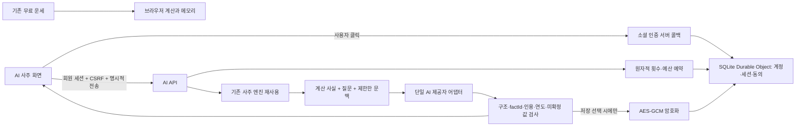

# AI 사주 준비 구현 — 구조와 데이터 흐름

확인일: 2026-10-28. 현재 공개본 2.4.1을 바탕으로 작업했다. 이번 단계는 로컬 구현·검증이며 공개 배포, 실제 제공자 로그인, 실제 AI 호출, 원격 저장소 생성은 하지 않는다.

## 선택한 구성

기존 Next.js `output: export`를 유지한다. `src/app/ai-saju/`는 정적 화면이고 서버 기능을 Next API route에 넣지 않았다. 별도 `worker/index.ts`가 동일 출처의 `/api/*`, `/auth/*`만 먼저 처리한다. 나머지는 Workers Static Assets이다. 기존 `wrangler.json`은 정적 배포 설정 그대로 남겼고 새로운 서버 구성은 `wrangler.ai.jsonc`에 분리했다.

계정·세션·예산을 **SQLite Durable Object 하나**가 관리한다. D1과 별도의 캐시를 함께 도입하지 않았다. 단일 authority 객체의 동기 SQLite 트랜잭션 안에서 계정별 한도, 단계, 동시 요청, 일/월 예산을 함께 검사·예약한다. 여러 Worker 요청이나 지역에서 접근해도 메모리 카운터와 eventual consistency에 의존하지 않는다. 초기 규모에서 단순한 구성이지만 이 authority가 처리량의 병목이 될 수 있다. 사용자 증가 시 실제 부하를 측정한 뒤 예산 authority를 유지한 분할 설계가 필요하다.

## 구현 경로

| 기능 | 파일 |
|---|---|
| 공개 AI 데이터 계약·횟수 정의 | `src/ai/contracts.ts` |
| AI 화면·메모리 대화 | `src/components/ai/AiSaju.tsx` |
| 서버 라우팅·회원 권한·CSRF | `worker/src/app.ts` |
| OAuth 제공자 어댑터 / Google JWT 검증 | `worker/src/oauth.ts` |
| 암호화·세션 쿠키·요청 길이 | `worker/src/security.ts` |
| 트랜잭션·한도·예산·삭제 | `worker/src/store.ts` |
| 재사용 계산과 기간 해석 | `worker/src/facts.ts` |
| AI 요청과 출력 검증 | `worker/src/model.ts` |
| 운영 설정·출시 게이트 | `worker/src/policy.ts` |
| 실제 Worker / private 운영 RPC | `worker/index.ts` |
| 로컬 전용 IdP와 모의 모델 | `worker/dev.ts`, `worker/local/model.ts` |
| 로컬·운영 DB 최초 스키마 | `worker/migrations/0001_initial.sql` |

## 계정과 인증

- Arctic 3.7.0의 OAuth 구성요소와 jose 6.2.13의 JWT 검증을 사용한다. Google은 Authorization Code + PKCE S256 + nonce이며 서명·issuer·audience·azp·exp·iat를 검증한다. Google scope는 `openid`뿐이다.
- Kakao/Naver는 서버에서 코드를 교환하고 공식 사용자 정보 endpoint에서 ID를 확인한다. Naver Arctic builder에는 state가 없어 일회용 state를 URL과 토큰 교환에 명시적으로 추가한다. 두 흐름에 Google의 PKCE/OIDC 지원을 억지로 가정하지 않는다.
- 제공자+고유 ID의 HMAC으로 식별한다. 이메일·이름으로 다른 제공자를 합치지 않는다. 소셜 프로필의 생일·성별은 사주에 사용하지 않는다.
- state, 브라우저 바인딩, 제공자, 만료를 함께 검사하고 성공/취소 시 일회 소비한다. callback URL은 `APP_ORIGIN`과 정해진 경로만 사용한다. 사용자가 보낸 redirect URL을 받지 않는다.
- 첫 인증 뒤 가입 대기는 10분이며, 약관·성인 대상 확인 전에는 회원을 만들지 않는다. 처리 근거·서비스 약관·AI 전송·선택 저장을 별도로 다룬다.
- 서비스 세션은 무작위 토큰, DB에는 해시만 저장한다. 운영 HTTPS 쿠키는 `__Host-`·HttpOnly·Secure·SameSite=Lax·Path=/이다. 최대 수명은 초안 12시간이다. 로그인 때 교체하고 로그아웃/탈퇴 때 폐기한다.
- 소셜 access/refresh token은 신원 확인 후 보관하지 않는다. 앱 연결 해제에는 같은 계정의 재인증을 사용한다. 실패해도 서비스 자료부터 삭제할 수 있고 외부 연결 확인 상태를 기록한다. 외부 제공자에서 먼저 해제한 사건의 자동 통지 구독은 등록하지 않았다. 제공자별 실제 통지 계약·서명/재전송 조건 확인 없이 임의 webhook을 열지 않으며 해당 경로는 404이다. 이 항목은 실제 제공자 연동 단계의 필수 확인/보완 항목이다.

## 실제 사용 단계와 예약

1. 비회원은 요청 body를 읽거나 계산하기 전에 401로 거부한다. 비회원 AI 체험·게스트 사용량 쿠키는 없다.
2. Origin/CSRF, 정책 상태와 AI 전송 동의를 확인한다. 길이·역할·조회 기간이 불명확하면 전송 전에 안내하며 유료 생성으로 세지 않는다.
3. 계정의 한국시간 날짜로 첫 진단 1회와 후속 질문 2회, 전체 3회를 관리한다. 한 계정의 진행 중 요청은 1개이다. 최초 진단 없이 후속 질문은 거부한다. 출생정보·브라우저·로그인 상태 변경으로 초기화하지 않는다. 진단 뒤 다른 출생정보의 후속 질문은 거부한다.
4. 최대 예상 비용을 일/월 버킷에 동시에 예약한다. 다른 계정의 요청도 같은 authority를 지나며 전체 동시 요청 상한이 적용된다. 매 요청은 사용자·내용에 연결된 idempotency key로 중복을 막는다.
5. 서버의 날짜와 기존 엔진으로 다시 계산한다. 한국 표준시, 음력 변환, 시간 모름/00:00, 절입/입춘 정책을 재사용한다. 원국·사용자 ID·횟수·현재 날짜를 클라이언트 주장으로 결정하지 않는다.
6. 단일 후보 어댑터는 Gemini 2.5 Flash-Lite이다. 아직 운영자의 채택 승인은 없다. endpoint/model은 코드 허용 목록에 고정되며, 서버 키·가격·예산·처리 정책을 갖추지 않으면 실제 호출하지 않는다. 입력 countTokens 후 한도를 검사하고 출력 토큰도 제한한다. 추가 검색·도구·이미지·비싼 모델 전환·자동 재생성은 없다.
7. 실제 usage가 있으면 그 수치를 정산한다. JSON/사실 검증 실패는 회원 횟수를 복구하지만 이미 든 제공자 비용은 기록한다. 실패 시도 제한은 유지한다. timeout 등 비용을 모르면 예약 상한을 보수적으로 정산하며 `cost_estimated`로 실제 계측과 구분한다. 예약보다 많이 보고되면 다음 호출을 즉시 중단한다.
8. 시작한 한국시간 날짜에 정산한다. 자정을 넘겨도 두 번 차감하지 않는다. Worker 중단의 잔여 예약은 정리 작업과 다음 요청의 만료 검사에서 처리한다.

처음 진단과 질문은 **사용자가 버튼을 누를 때만** 생성한다. 회원가입·로그인·페이지 진입·새로고침은 생성이 아니다. 비저장 답변은 서버에 복원용 캐시를 두지 않는다. 완료 뒤 응답을 잃고 같은 요청을 재전송하면 새로 호출하지 않고 이미 처리됐음을 알린다. 브라우저에 남아 있거나 선택 저장한 답변을 다시 읽는 것은 추가 사용이 아니다. 연결이 끊긴 뒤 이미 완료된 비저장 답변은 복원되지 않을 수 있으며 자동 무료 재생성하지 않는다.

## 저장·삭제

현재 SQL 테이블은 users, auth_accounts, sessions, auth_transactions, pending_signup, consents, reservations, budgets, settings, saved_items, unlink_events, action_rates이다. 질문/답변 원문과 출생 원자료를 reservations나 로그에 넣지 않는다. 선택 저장한 birth/conversation만 saved_items에 AES-GCM으로 암호화한다. 키는 DB 외부 비밀 설정이며 소유자+자료 종류+ID를 AAD로 묶는다. 다른 회원의 ID로 조회/삭제하면 404이다.

저장한 자료를 삭제하거나 로그아웃하면 사용자 generation을 올려, 기존 요청이 늦게 끝나 자료를 다시 저장하지 못하게 한다. 계정 탈퇴는 FK cascade로 계정·세션·동의·저장 자료를 지우며 진행 중 요청은 개인정보를 되살릴 수 없다. 비용 예약은 별도로 정산한다.

초안 만료는 선택 자료 90일, 남용 방지 식별 요약 7일, 원문 없는 비용 기록 30일이다. 7일 뒤 사용량의 사용자 연결·프로필 해시 등을 없애고 30일 뒤 요청 기록도 정리한다. 보유기간은 법정 기간이라는 뜻이 아니다. 정리는 평상시 최대 1시간 주기이며 유효기간이 지난 자료는 API에서도 즉시 조회하지 못한다. Cloudflare 백업/복제본과 외부 AI 업체의 보관·삭제는 실제 설정과 계약을 확인해야 한다.

## 운영 제어와 한계

`AiOperations`는 HTTP 관리자 페이지가 아닌 Service Binding 전용 RPC entrypoint이다. `summary`, `sampleUsage`, `setPaused`는 원문/회원 정보 없이 사용량·비용 집계와 중단만 다룬다. 임의 SQL이나 회원 대화 열람을 제공하지 않는다. 외부 `/api/admin`과 같은 경로를 만들지 않았다. 운영자가 허가한 내부 Worker 바인딩으로만 연결해야 한다.

가격은 확인 날짜·출처와 함께 설정하며 31일을 넘겨 재확인하지 않으면 실제 AI 호출이 닫힌다. 설정 금액은 앱이 사용하는 요율이며, 제공자의 가격 변경·세금·Cloudflare 인프라 청구까지 같은 금액으로 보장하는 것은 아니다. 외부 알림은 강제 결제 상한으로 간주하지 않는다.

구조화 응답의 factId·quote와 알려진 연도·간지·미확정 값은 검증하지만, 자유 문장의 모든 의미를 형식 검사로 인증할 수는 없다. 실제 모델의 한국어·질문 대응·추론 품질은 운영자 설정 후 20건 이상으로 별도 검증한다. 로컬 모의 응답은 실제 모델 답변으로 표현하지 않는다.

## 2026-10-29 후속 변경

기존 공개 Worker와 `/api/*`·`/auth/*`를 기본 `wrangler.json`에서 함께 제공한다. 분리 스테이징은 `wrangler.ai.staging.jsonc`다. 가입/AI 설정 부족은 실제 서버에서 계속 차단하며, 코드 배포 금지는 해제했다. 이번 실제 배포 결과는 review-report.md를 따른다.

스키마 2는 원래 스키마를 변경/삭제하지 않고 identity_revocations, unlink_jobs, request_metrics를 추가한다. 카카오 인증 통지→durable outbox/즉시 세션 철회→persistent alarm 삭제 순서다. 콜백이 시작된 뒤 철회가 오면 과거 인증이 회원 세션을 되살리지 못하도록 장벽을 검사한다. 새 계정/같은 payload의 지연 통지 경계와 공식 SLA는 실제 제공자 검증이 필요하다.

timeout을 최대 비용으로 추정 정산한 뒤 실제 usage가 늦게 도착하면 비용만 한 번 보정한다. 실패 상태·이용권 복구·삭제한 자료를 다시 성공 상태로 돌리지 않는다. 내부 사용량 export에 단계별 지연/재시도(자동 재시도 없음)와 thinking 포함 출력 token을 추가했다.

비저장 결과는 서버 임시 복구 저장소를 추가하지 않는다. 응답 전 단절이면 횟수만 반영될 수 있음을 안내하고, 도착한 대화는 기기 내 복사/텍스트 파일로 내보낼 수 있다. 재접속 시 동일 출생정보로 남은 질문은 이용 가능하나 이전 문맥은 복원되지 않는다. 이 제한을 숨기거나 장기 저장을 몰래 활성화하지 않는다.
